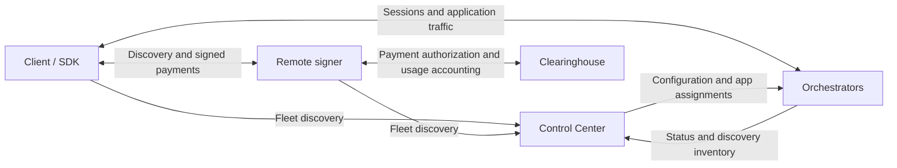
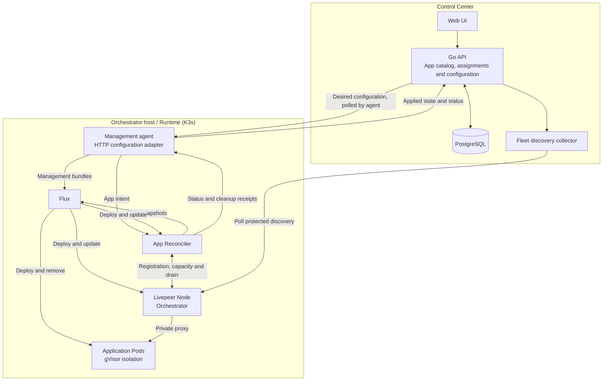

# Livepeer Control Center

Control Center manages onboarding and configuration for Livepeer orchestrators.

## Connect a node

Sign in to Control Center and copy your enrollment command. Prepare the
[prerequisite packages](runtime/README.md#prerequisites) on a Debian or Ubuntu
amd64 systemd host with 2 CPUs, 4 GiB RAM, and 10 GiB free. Run as root:

```sh
# Disable shell tracing before entering the token.
set +x
curl -fsSL https://controlcenter.livepeer.live/bootstrap.sh | LIVEPEER_ENROLLMENT_TOKEN='<TOKEN>' sh -
```

The loader downloads and verifies a complete release bundle. See the [Runtime guide](runtime/README.md) for more details.

## Architecture

Clients discover available apps through Control Center, pay through a
clearinghouse, and send application traffic to orchestrators.



### Control Center and Runtime

Each managed host runs Runtime on K3s. Its management agent polls Control Center
for desired configuration and reports applied state. Flux deploys workloads; the
App Reconciler manages app instances and their registration with Livepeer Node,
which owns sessions, capacity, and private proxying to app Pods. The bundled
Runtime starts Node in offchain mode.



## Documentation

- [Managed onchain operation](docs/onchain-operation.md): configure fresh deployments and inspect payment readiness.
- [App registry](docs/app-registry.md): publish app definitions and assign revisions to machines.
- [Fleet discovery](docs/fleet-discovery.md): expose managed orchestrators through an aggregate inventory.
- [Machine status](docs/machine-status.md): inspect rollout, configured health, registration, discovery and cleanup evidence.
- [Machine ingress](docs/machine-tunnels.md): configure protected tunnels and routing.
- [Operations](docs/operations.md): configure authentication and administrator access.
- [Development](docs/development.md): run locally, build, and test.
