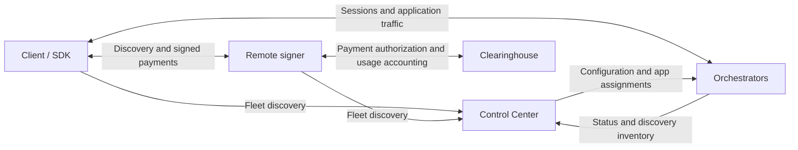
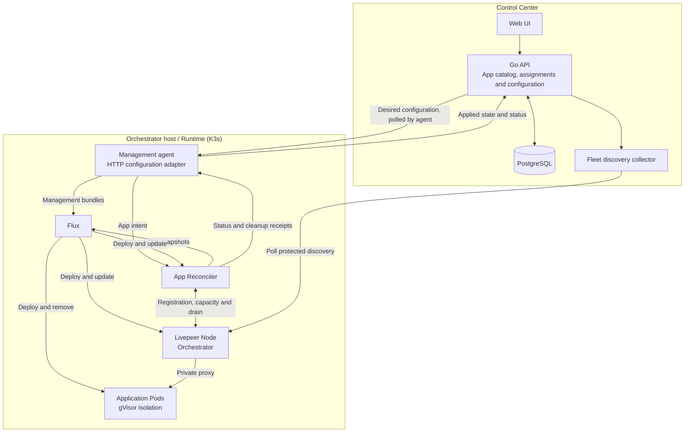

# Livepeer Control Center

Control Center manages onboarding and configuration for Livepeer orchestrators.

## Connect a node

Sign in to Control Center and copy your enrollment token. On a Debian or Ubuntu
amd64 systemd host with 2 CPUs, 4 GiB RAM, and 10 GiB free, run from the
repository checkout:

```sh
cd runtime
export LIVEPEER_API_URL=https://your-control-center-api.example
export LIVEPEER_RUNTIME_IMAGE=your-registry/livepeer-runtime@sha256:<published-digest>
sudo --preserve-env=LIVEPEER_API_URL,LIVEPEER_RUNTIME_IMAGE ./bootstrap-livepeer.sh --token <TOKEN>
```

Use the Runtime image published by your deployment. The Control Center API's
`PublicAPIURL` must match `LIVEPEER_API_URL` and be reachable by the host and its
Kubernetes pods. See the [Runtime guide](runtime/README.md) for prerequisites,
installation options, and upgrades.

## Architecture

Clients discover available apps through Control Center, pay through a
clearinghouse, and send application traffic to orchestrators.



### Control Center and Runtime

Each managed host runs Runtime on K3s. Its management agent polls Control Center
for desired configuration and reports applied state. Flux deploys workloads; the
App Reconciler manages app instances and their registration with Livepeer Node,
which owns sessions, capacity, and private proxying to app Pods. The bundled
Runtime starts Node in offchain mode.



## Documentation

- [App registry](docs/app-registry.md): publish app definitions and assign revisions to machines.
- [Fleet discovery](docs/fleet-discovery.md): expose managed orchestrators through an aggregate inventory.
- [Machine ingress](docs/machine-tunnels.md): configure protected tunnels and routing.
- [Operations](docs/operations.md): configure authentication and administrator access.
- [Development](docs/development.md): run locally, build, and test.
