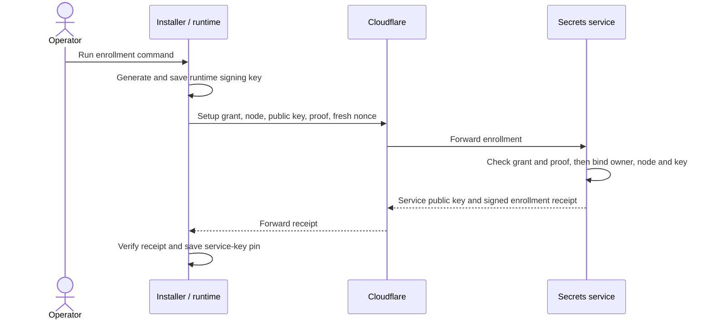

# Operator secrets

The secrets service stores application credentials and controls which runtimes
may receive them. Operators add or replace credentials through the Secrets
screen. Control Center manages application assignments and sees secret names,
but it receives neither secret values nor runtime private keys.

The browser encrypts each value with a random **data key**. The service stores
the encrypted value and uses Vault Transit to encrypt, or **wrap**, its data key
for storage. For an authorized runtime, the service asks Vault to unwrap the
key and encrypts it to the runtime for delivery with HPKE. The runtime decrypts
the key and value locally and supplies the value to the application.

## Enrollment and identity

Generate the enrollment command in the UI once in each browser or profile that
manages secrets. This pins the service signing key for that secrets origin in
the browser. A changed pin is refused. The command's setup grant authorizes
enrollment for one hour. The installer creates and saves a signing key pair
for the runtime. The private key stays on the machine; the service records the
public key so it can check signatures on later requests.



The service has its own signing key pair. Its receipt binds both identities
and a fresh random challenge, called a nonce, so an old receipt cannot complete
a new attempt. The installer saves the service public key as a **pin**: the key
it must use to verify future replies. Retries preserve both the runtime key and
the pin. The runtime then activates its binding with a signed request.

### Cloudflare's role

We trust Cloudflare during enrollment to deliver the correct initial service
key. The installer has no pin yet, so a signature alone cannot prove that the
first key belongs to the intended service. Cloudflare could substitute that
initial key and receipt. This is the trust decision made at enrollment.

Afterward, the runtime checks service replies, including denials, against its
saved pin. Cloudflare can relay or block traffic, but it cannot replace the
pinned identity or modify a reply without verification failing.

For uploads, the browser verifies the service's signed encryption key against
its pin and uses HPKE to encrypt the data key to the service. For delivery,
the runtime creates a fresh in-memory HPKE key for each request. The service
checks authorization and encrypts the unwrapped data key to that runtime key.
Signed requests bind the runtime key, and signed replies are bound to requests.
Cloudflare can see metadata and bearer tokens, but not usable data keys on
these encrypted paths when the clients are honest.

Browser security also depends on the JavaScript it receives. An attacker able
to alter that code, including at Cloudflare, could bypass browser encryption.
Enrollment and owner-authorized identity resets still use bearer credentials
that Cloudflare can observe. Those authorization paths remain trusted; HPKE
protects data keys in transit rather than replacing operator authentication.

## Deployment

1. Deploy on infrastructure administered separately from Control Center, with
   its own TLS PostgreSQL database, Vault instance and Cloudflare tunnel.
   Route the tunnel's public hostname to `http://secrets:8080`. The Compose
   project keeps that origin private and publishes no host port.

2. Create the files named in [Compose](../deploy/compose.secrets.yaml)
   under `deploy/secrets-service-private/`. Keep them owner-only, readable by
   UID 65532, and out of Git. Generate the service identity key once:

   ```sh
   openssl genpkey -algorithm ED25519 \
     -out deploy/secrets-service-private/identity-key.pem
   ```

   Compose mounts this as `SECRETS_IDENTITY_KEY_FILE`. Generate a separate
   X25519 key for upload encryption:

   ```sh
   openssl genpkey -algorithm X25519 \
     -out deploy/secrets-service-private/encryption-key.pem
   ```

   Compose mounts it as `SECRETS_ENCRYPTION_KEY_FILE`. Preserve both keys
   across redeployments, separately from the enrollment-token signing secret.

3. Enable Vault Transit at `transit/`. Grant `create,update` on
   `transit/encrypt/operator-<owner UUID>` and `update` on its decrypt path.
   Do not grant key export or administration. Disable raw Vault audit and
   ingress body logging so credentials and data keys are not recorded.

4. Set `SECRETS_PUBLIC_URL` and Control Center's `SecretsURL` to the same public
   HTTPS origin. Set `SecretsMetadataTokenFile` to an independent credential
   of at least 32 bytes. Set the service's `CONTROL_METADATA_TOKEN_FILE` to the
   mounted file containing that same credential. Supply the remaining Compose
   settings, then start the separate project:

   ```sh
   docker compose -f deploy/compose.secrets.yaml up --build -d
   ```

## When an application's secrets change

Applications declare their secret references in `container.secrets`; the runtime
provides their values as environment variables. An application instance is one
running copy of an app. Replacing a secret replaces affected instances one at a
time, waiting for each replacement to become ready. A single-instance app has
downtime during this process.

Running instances continue during a service or Vault outage. Starting or
restarting an instance that needs secrets requires current authorization.
Deleting a secret or denying an app stops affected instances, although active
sessions and offline machines can delay removal. To invalidate credentials
already delivered to an app, revoke them at their issuer as well.

## Recovery

Back up the service database, Vault state, machine identity files, encrypted
Kubernetes state, runtime journal, signing keys and the service encryption key.
The database alone cannot recover values without Vault's wrapping keys. Keep
key backups separate from database backups. Preserve revocations and deletions
when restoring old data.

Losing the service identity key breaks verification on enrolled runtimes.
Restore the original private key instead of silently replacing their pins.
For a compromised runtime key, use owner-authorized
`POST /v1/machines/{node}/reset`, then enroll again. To revoke access without
resetting the identity, use `POST /v1/machines/{node}/revoke`.
Upgrade the service, installer and runtime together, then rerun enrollment to
install the pin. Existing clusters must first complete
[K3s secrets encryption](https://docs.k3s.io/cli/secrets-encrypt).
