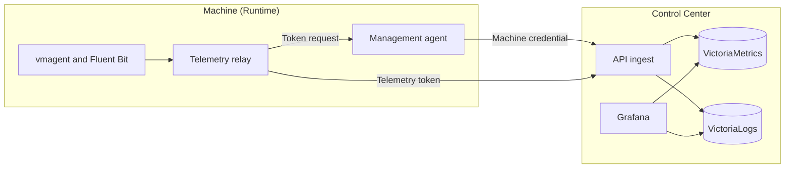

# Machine telemetry

Managed machines push metrics and logs to Control Center for administrator viewing in Grafana. Telemetry is enabled fleet-wide by default with no per-machine opt-out.



## Machine collection and buffering

Control Center delivers the `livepeer-telemetry` Flux Kustomization when `TelemetryEnabled` is `true` and the latest report lists installed `host-telemetry`. Bootstrap creates the telemetry socket, management agent RBAC, and host feature record.

Older Runtime images need a telemetry-capable bootstrap rerun with `--upgrade-runtime` (plain reruns keep saved images). `deletionPolicy: Delete` removes agents when disabled, and telemetry never changes Node's drain digest.

Both Deployments in `livepeer-telemetry` use the Pod network without host ports.

- `livepeer-telemetry-agent` runs the collecting agents and relay on Pod loopback.
- `livepeer-telemetry-node-exporter` reads host `/proc`, `/sys`, and `/` as UID `65533`. Read-only mounts, no shared group, and no service-account token restrict access to world-readable paths. Only the agent Pod can connect on TCP `9100`.

- `livepeer-telemetry-agent` hosts every container except `node-exporter` on Pod loopback only with zero inbound traffic.
- `livepeer-telemetry-node-exporter` mounts host `/proc`, `/sys`, `/` read-only as UID `65533` with no service-account token or shared group (world-readable paths only, isolated from `65532`-owned sockets/state), admitting only the agent Pod on TCP `9100`.

| Container | Collects |
| --- | --- |
| `node-exporter` | Host CPU, memory, disk, filesystems, pressure, sensors |
| `kube-state-metrics` | Pod, Deployment, DaemonSet, ReplicaSet, node state |
| `vmagent` | Scrapes above, kubelet, cAdvisor (`id="/"` host network), Node, Traefik, CoreDNS, Flux every `30s` |
| `fluent-bit` | System/app logs, `logs/k3s.log`, `logs/bootstrap.log`, kernel/Runtime journals, K8s events |
| `relay` | Holds telemetry token and forwards streams |

`vmagent` drops labels that mention sessions, tokens, tickets, secrets, passwords, or credentials. Fluent Bit caps lines at 16 KiB and app output at 200 lines/s per machine. It reads root-owned `0640` logs as UID 0 with all capabilities dropped and a read-only root. The other containers in `livepeer-telemetry-agent` run as UID `65532`.

During outages, `vmagent` buffers ~`512 MiB` (smallest supported queue) in `volumes/telemetry/<NODE_ID>` and Fluent Bit buffers `128 MiB` in `volumes/telemetry-logs/<NODE_ID>` (about 22 minutes at 100 KiB/s growth). Full buffers drop oldest data and resend within budget after recovery. Buffers are enrollment-scoped, and re-enrollment stops agents and deletes prior buffers before issuing new credentials.

## Credentials and identity

The relay requests tokens over `volumes/management-sockets/telemetry` from the management agent (sole machine credential holder), which calls `POST /v1/nodes/<NODE_ID>/telemetry/token` and returns the token plus URLs under its approved `/v1/nodes/<NODE_ID>/` origin (HTTPS only, HTTP on dev installs). The relay pins to its bundle's node ID and renews at half lifetime.

Tokens are Ed25519 JWTs signed with the [shared signing key](discovery-auth.md) (`aud=livepeer-telemetry`, `scope=telemetry:write`, `sub=<node_id>`, orchestrator address, credential version, lifetime `TelemetryTokenTTL`). Machine ingress rejects telemetry tokens and ingest rejects discovery tokens.

Retired enrollments get zero tokens, and replicas reload active enrollments every `ConfigReconcileInterval` to revoke tokens after refresh, retirement, or removal within ~1 interval (DB errors keep the prior list, initial load returns `503`). The API builds upstream URLs directly, drops client query params, sets upstream `Content-Type`, and stamps `node_id` and `orchestrator` from token claims.

## Ingest contract

| Endpoint | Accepts | Upstream |
| --- | --- | --- |
| `POST /v1/nodes/<NODE_ID>/telemetry/metrics` | Prometheus/VictoriaMetrics remote write (`application/x-protobuf`, `snappy`/`zstd`) | VictoriaMetrics `/api/v1/write` (`extra_label` identity) |
| `POST /v1/nodes/<NODE_ID>/telemetry/logs` | JSON lines (`application/json` or `application/x-ndjson`, optional `gzip`/`zstd`) | VictoriaLogs `/insert/jsonline` (`extra_fields` identity) |

Log lines carry `time` and `message`, and VictoriaLogs streams key on `node_id`, `source`, `namespace`, `pod`, `container`.

Requests need `Content-Length <= TelemetryMaxBodyBytes`. Bundles size relay to that limit and `vmagent` uncompressed blocks to `TelemetryMaxBodyBytes - 64 KiB` (max `4 MB`), restarting only the agent Pod on change. Separate per-replica metrics and logs budgets enforce `TelemetryNodeRateBytes`/s with burst `2 × TelemetryMaxBodyBytes`.

| Status | Meaning | `vmagent` (via relay) | Fluent Bit |
| --- | --- | --- | --- |
| `204` | Stored | Continue | Continue |
| `400` | Empty body or parse error | Drop block | Drop chunk |
| `401` | Missing, invalid, expired, or revoked token | Relay drops the token and returns `503`. Agent retries with a fresh token. | Same |
| `403` | Disabled or wrong machine | Retry | Drop chunk |
| `411`, `415` | Missing length or unsupported encoding | Retry | Drop chunk |
| `413` | Oversized buffered body after limit reduction | Relay returns `409` so `vmagent` drops the block | Drop chunk |
| `429` | Rate limit exceeded (`Retry-After`) | Retry after delay | Same |
| `503` | Loading enrollments or storage unavailable | Retry from disk | Same |

## Configure telemetry

| Setting | Default | Purpose |
| --- | --- | --- |
| `TelemetryEnabled` | `true` | Enable tokens and ingest (`false` stops fleet-wide) |
| `TelemetryMetricsURL` | `http://victoriametrics:8428` | Private VictoriaMetrics origin |
| `TelemetryLogsURL` | `http://victorialogs:9428` | Private VictoriaLogs origin |
| `TelemetryTokenTTL` | `1h` | Token lifetime (`1m`–`1h`) |
| `TelemetryMaxBodyBytes` | `8388608` | Max request body (`1 MiB`–`64 MiB`) |
| `TelemetryNodeRateBytes` | `1048576` | Sustained bytes/s per machine and kind (min `64 KiB`/s) |
| `TelemetryAppLogsEnabled` | `true` | Collect app logs (`false` keeps them local) |

Storage, retention, and Grafana access live in [telemetry storage](../deploy/README.md#telemetry-storage).

## Dashboards

Grafana provisions read-only dashboards from `deploy/grafana/dashboards` into **Telemetry**, filterable by `node_id` and `orchestrator`.

| Dashboard | Contents |
| --- | --- |
| **Fleet overview** | Reporting machines, silent `>= 5m` (seen in `7d`), restarts, OOM kills, per-machine CPU/memory/disk/network |
| **Machine detail** | Host stats, per-Pod usage, restarts, Node app calls, ingress requests, log volume, recent logs |
| **Machine logs** | Logs filtered by machine, source, and regex |
| **Telemetry pipeline** | Ingest rates/rejections, relay errors, token expiry, buffers, storage size |

## Diagnose telemetry

VictoriaMetrics scrapes the private API's `/metrics`. Telemetry counters use only `kind` and `reason` labels.

- `control_telemetry_tokens_issued_total`
- `control_telemetry_ingest_requests_total`
- `control_telemetry_ingest_bytes_total`
- `control_telemetry_ingest_rejected_total`

Storage errors log once per minute per kind and reason, with a count of suppressed events. Tokens stay out of logs and labels.

| Symptom | Check |
| --- | --- |
| `401` single machine | Credential refresh/retirement and management agent token fetches |
| `401` all machines | Signing key ID and public keys after [key rotation](discovery-auth.md#rotate-signing-keys) |
| `503` `upstream_unavailable` | `victoriametrics` and `victorialogs` running on `telemetry` network |
| `upstream_rejected` | API logs for storage error response |
| No telemetry | `host-telemetry` in installed software on status page, or rerun bootstrap with `--upgrade-runtime` (plain reruns keep older images), then inspect Pod and pipeline dashboard |

```sh
kubectl -n flux-system get kustomization livepeer-telemetry
kubectl -n livepeer-telemetry get pods
kubectl -n livepeer-telemetry logs deployment/livepeer-telemetry-agent -c relay
```
