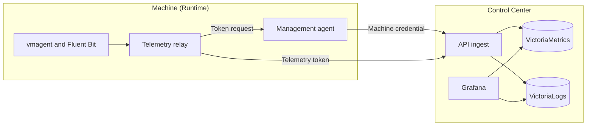

# Machine telemetry

Managed machines push metrics and logs to Control Center. Administrators read
them in Grafana. Telemetry is on by default and fleet-wide; operators cannot
opt out per machine.



## Machine collection

Control Center delivers the `livepeer-telemetry` Flux Kustomization only when
`TelemetryEnabled` is true and the machine's latest runtime report lists the
installed `host-telemetry` software entry. Bootstrap records that entry after
applying the telemetry management socket and the management agent's RBAC, and
the management agent reports it only from this release's Runtime image. Older
installations keep running unchanged until they rerun an updated bootstrap with
`--upgrade-runtime`; a plain rerun keeps the saved Runtime image. The
Kustomization uses `deletionPolicy: Delete`: disabling telemetry removes the
agents. Telemetry never changes Node's drain digest.

Two Deployments in the `livepeer-telemetry` namespace run on the Pod network
with no host ports:

- `livepeer-telemetry-agent` holds every agent except node_exporter. Its
  containers listen on the Pod loopback only, and nothing may connect to it.
- `livepeer-telemetry-node-exporter` reads the host's `/proc`, `/sys` and `/`
  read-only. It runs as UID 65533 with no service-account token and no shared
  group, so it reaches only world-accessible host paths, never the 65532-owned
  management sockets or workload state. Its NetworkPolicy admits only the agent
  Pod, on TCP 9100.

| Container | Collects |
| --- | --- |
| `node-exporter` | Host CPU, memory, disk, filesystems, pressure and hardware sensors |
| `kube-state-metrics` | Pod, Deployment, DaemonSet, ReplicaSet and node state |
| `vmagent` | Scrapes the above, kubelet and cAdvisor (host network traffic comes from the root cgroup, `id="/"`), Node, Traefik, CoreDNS and Flux every 30 seconds |
| `fluent-bit` | System Pod logs, app container output, `logs/k3s.log`, `logs/bootstrap.log`, kernel and Runtime unit journal entries, and Kubernetes events |
| `relay` | Holds the telemetry token and forwards both streams to Control Center |

vmagent drops any label whose name mentions sessions, tokens, tickets, secrets,
passwords or credentials before it writes. Fluent Bit truncates lines at
16 KiB and throttles app output to 200 lines per second per machine. Kubelet and
journald write root-owned `0640` files, so Fluent Bit runs as UID 0 with every
capability dropped and a read-only root filesystem: it reads through owner
permissions only. The other agents run as UID 65532.

Both agents buffer on disk while Control Center is unreachable: vmagent up to
about 512 MiB in `volumes/telemetry/<NODE_ID>` (its smallest supported queue),
and Fluent Bit up to 128 MiB in `volumes/telemetry-logs/<NODE_ID>`. When a
buffer is full, the oldest data is dropped. After an outage the agents resend
from the buffer, within each machine's ingest budget. Buffers belong to one
enrollment: re-enrollment stops the agents and deletes the previous
enrollment's buffers before new credentials are issued, so no data is sent
under another identity.

## Credentials and identity

The relay asks the management agent for a token over its own Unix socket,
`volumes/management-sockets/telemetry`. The management agent alone holds the
machine credential. It exchanges that credential for a telemetry token at
`POST /v1/nodes/<NODE_ID>/telemetry/token`, and returns the token with
destination URLs built from its approved Control Center origin. The relay
accepts only HTTPS destinations (plain HTTP only on development installations)
on one origin under `/v1/nodes/<NODE_ID>/`, so
neither the bundle nor the relay can redirect telemetry. The relay is pinned to
its bundle's node ID and refuses a grant for any other node; after
re-enrollment, an old relay cannot send under the new identity. It renews the
token at half its lifetime. When Control Center answers 401, the relay drops
the token and returns 503, so the agent retries from its buffer with a fresh
token. The token is an Ed25519 JWT signed
with the [discovery signing key](discovery-auth.md). It has audience
`livepeer-telemetry`, scope `telemetry:write`, the node ID as subject, and the
orchestrator address and credential version as claims. Its lifetime is
`TelemetryTokenTTL` (one hour by default, at most one hour). Machine ingress
rejects telemetry tokens, and the ingest endpoints reject discovery tokens.

Retired enrollments receive no token. The ingest endpoints compare each token
with the current enrollments, which every API replica reloads on each
reconciliation pass (`ConfigReconcileInterval`). Credential refresh, retirement
and removal therefore revoke outstanding tokens within about one interval. A
failed database read keeps the previous enrollments; until the first read
succeeds, ingest returns 503.

The API writes to storage with an upstream URL it builds itself. Client query
parameters are discarded, and the API sets the upstream `Content-Type`, so no
request body can be read as form parameters. The API overrides `node_id` and
`orchestrator` on every series and log entry with the token's identity, so a
machine cannot write data as another machine.

## Ingest

| Endpoint | Accepts | Upstream |
| --- | --- | --- |
| `POST /v1/nodes/<NODE_ID>/telemetry/metrics` | Prometheus or VictoriaMetrics remote write: `application/x-protobuf` with `snappy` or `zstd` encoding | VictoriaMetrics `/api/v1/write` with `extra_label` identity |
| `POST /v1/nodes/<NODE_ID>/telemetry/logs` | JSON lines (`application/json` or `application/x-ndjson`), optionally `gzip` or `zstd` encoded | VictoriaLogs `/insert/jsonline` with `extra_fields` identity |

Log entries carry `time` and `message`. VictoriaLogs streams are keyed by
`node_id`, `source`, `namespace`, `pod` and `container`.

Requests need `Content-Length` and at most `TelemetryMaxBodyBytes` (8 MiB by
default). Bundles size agent writes from this setting: the relay uses the same
limit, and vmagent's largest uncompressed block is 64 KiB below it (at most
4 MB). Changing it restarts the agent Pod only. Each machine has a separate
byte budget for metrics and for logs: `TelemetryNodeRateBytes` per second
(1 MiB by default), with a burst of two maximum-size bodies. Budgets are per
API replica.

Control Center answers, and the agents react:

| Status | Meaning | vmagent (through the relay) | Fluent Bit |
| --- | --- | --- | --- |
| 204 | Stored | Continue | Continue |
| 400 | Empty body, or storage could not parse it | Drop the block | Drop the chunk |
| 401 | Missing, invalid, expired or revoked token | The relay drops the token and answers 503; retry with a new token | Same |
| 403 | Telemetry disabled, or the token names another machine | Retry | Drop the chunk |
| 411, 415 | Missing length or unsupported encoding | Retry | Drop the chunk |
| 413 | Body over `TelemetryMaxBodyBytes` | The relay answers 409; drop the block | Drop the chunk |
| 429 | Machine budget exceeded; see `Retry-After` | Retry after the delay | Same |
| 503 | Enrollments loading or storage unavailable | Retry from the disk buffer | Same |

The 413 case arises only for blocks buffered before the limit was lowered;
without the relay's 409, vmagent would retry such a block forever on its single
queue.

## Configuration

| Setting | Default | Purpose |
| --- | --- | --- |
| `TelemetryEnabled` | `true` | Accept tokens and ingest. Set `false` to stop telemetry fleet-wide. |
| `TelemetryMetricsURL` | `http://victoriametrics:8428` | Private VictoriaMetrics origin |
| `TelemetryLogsURL` | `http://victorialogs:9428` | Private VictoriaLogs origin |
| `TelemetryTokenTTL` | `1h` | Telemetry token lifetime, 1m to 1h |
| `TelemetryMaxBodyBytes` | `8388608` | Largest request body, 1 MiB to 64 MiB |
| `TelemetryNodeRateBytes` | `1048576` | Sustained bytes per second per machine and kind |
| `TelemetryAppLogsEnabled` | `true` | Collect app container output |

App container output is stored centrally and visible to administrators. Set
`TelemetryAppLogsEnabled = false` to keep it on machines.

The storage services, retention and Grafana access are described in the
[deployment guide](../deploy/README.md#telemetry-storage).

## Dashboards

Grafana provisions read-only dashboards from `deploy/grafana/dashboards` into
the **Telemetry** folder:

- **Fleet overview:** machines reporting, machines silent for 5 minutes (among
  those seen in the last 7 days), restarts, OOM kills, and CPU, memory, disk
  and network for each machine.
- **Machine detail:** host stats, per-Pod usage, container restarts, Node app
  calls, ingress requests, log volume and recent logs for one machine.
- **Machine logs:** logs filtered by machine, source and regular expression.
- **Telemetry pipeline:** ingest rates and rejections, relay failures, token
  expiry, agent buffers and storage size.

Every series and log entry carries `node_id` and `orchestrator`, so dashboards
can filter by orchestrator.

## Diagnose

Control Center's `/metrics` reports ingest counters with `kind` and `reason`
labels only:

- `control_telemetry_tokens_issued_total`
- `control_telemetry_ingest_requests_total`
- `control_telemetry_ingest_bytes_total`
- `control_telemetry_ingest_rejected_total`

VictoriaMetrics scrapes these through the private network. The API logs
storage refusals and outages at most once a minute per kind and reason, with a
count of suppressed events. Logs and metric labels never contain tokens.

- **401 for one machine:** check whether the enrollment was refreshed or
  retired, and whether the management agent can still fetch new tokens.
- **401 for every machine:** check the signing key ID and the public
  verification keys after a [key rotation](discovery-auth.md#key-rotation).
- **503 with `upstream_unavailable`:** check that `victoriametrics` and
  `victorialogs` are running and on the `telemetry` network.
- **`upstream_rejected`:** the API log entry includes the storage response.
- **No telemetry from a machine:** confirm `host-telemetry` appears among the
  installed software on its status page; if not, rerun the current bootstrap
  with `--upgrade-runtime`. A plain rerun keeps the saved Runtime image, which
  may predate telemetry.
  Then check the agent Pod and the relay's metrics on the pipeline dashboard:

  ```sh
  kubectl -n flux-system get kustomization livepeer-telemetry
  kubectl -n livepeer-telemetry get pods
  kubectl -n livepeer-telemetry logs deployment/livepeer-telemetry-agent -c relay
  ```
